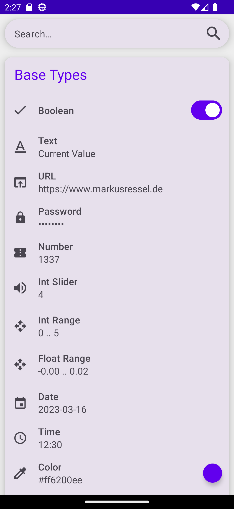
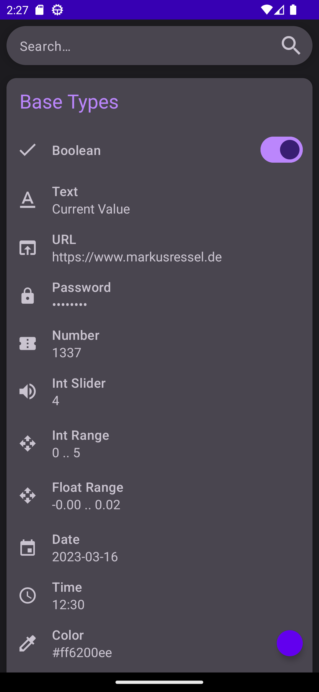

# KutePreferences | [](https://codebeat.co/projects/github-com-markusressel-kutepreferences-master) |

A Material Design 3 **GUI** library for easy to use, fast and beautiful **preferences** in your app.

<p align="center">
    
</p>

# Features

* [x] Material Design 3
* [x] Easy to use
* [x] Many included preference types
* [x] Expandable with custom styles and logic
* [x] Integrated search
* [x] Persistence
* [x] Written entirely in Kotlin & Compose

# How to use

Have a look at the demo app (`app` module) for a complete sample. The demo uses Hilt for dependency injection, but
KutePreferences does not require it.

## Gradle

Add JitPack to your repositories:

```kotlin
dependencyResolutionManagement {
    repositories {
        google()
        mavenCentral()
        maven(url = "https://jitpack.io")
    }
}
```

Then add the `ui` module, which includes `core`, to your app module. Replace `<version>` with the
[latest release](https://github.com/markusressel/KutePreferences/releases):

```kotlin
android {
    compileOptions {
        // required because KutePreferences uses java.time, which is not available on older Android versions
        isCoreLibraryDesugaringEnabled = true
    }
}

dependencies {
    implementation("com.github.markusressel.KutePreferences:ui:<version>")
    coreLibraryDesugaring("com.android.tools:desugar_jdk_libs:2.1.5")
}
```

Use the `core` module on its own if you only need the items and their persistence, without the Compose UI.

## Create a ViewModel

Extend `KutePreferencesViewModel` and pass the items that should be shown to `initPreferencesTree`:

```kotlin
class SettingsViewModel(context: Context) : KutePreferencesViewModel() {

    private val dataProvider = DefaultKutePreferenceDataProvider(context)

    val username = KuteTextPreference(
        key = "username",
        title = context.getString(R.string.title_username),
        defaultValue = "",
        dataProvider = dataProvider,
    )

    init {
        initPreferencesTree(listOf(username))
    }

}
```

Keys and titles are plain strings, so you can use string resources or build keys at runtime. Do not change a key after
a release: the saved value is stored under it.

To let the compiler catch typos, define your keys in one place instead of repeating them as literals:

```kotlin
object Keys {
    const val USERNAME = "username"
    fun accountSync(id: Long) = "account_${id}_sync"
}
```

Items of one data provider can share a key to show the same value. `initPreferencesTree` throws an
`IllegalArgumentException` if such items have a different value type or default value, because that usually is a copy
and paste mistake. It cannot detect a pasted item whose key, type and default value are all unchanged.

Read the current value anywhere through `username.getCurrentPersistedValue()`, or observe it with
`username.getPersistedValueFlow()`.

## Render the UI

```kotlin
@Composable
fun SettingsScreen() {
    val context = LocalContext.current.applicationContext
    val viewModel = viewModel { SettingsViewModel(context) }

    KutePreferencesTheme {
        KutePreferencesScreen(
            modifier = Modifier.fillMaxSize(),
            kuteViewModel = viewModel,
        )
    }
}
```

The screen handles the back button itself: it closes the search and then leaves the current category. It animates
between categories, returns to the previous scroll position when going back, and reopens the same categories after your
app was killed in the background. On Android 13 and 14, add `android:enableOnBackInvokedCallback="true"` to your manifest
to get the predictive back gesture.

Inside of a category, the screen shows a header with the title, the parent categories and a back button. If your app
shows this in its own top bar, hide the header and read the open categories from the ViewModel:

```kotlin
val uiState by viewModel.preferencesUiState.collectAsStateWithLifecycle()
val title = uiState.categoryPath.lastOrNull()?.title

KutePreferencesScreen(
    kuteViewModel = viewModel,
    categoryHeader = {},
)
```

## Structure

The items that you pass to `initPreferencesTree` are a direct representation of the categories, sections, preferences
and custom items that will be visible in your app. Items that need persistence require a `KutePreferenceDataProvider`
parameter that defines how their value is saved:

| Name                                  | Description                                                              |
|---------------------------------------|--------------------------------------------------------------------------|
| `DefaultKutePreferenceDataProvider`   | Stores values in the `SharedPreferences` of your app.                    |
| `DataStoreKutePreferenceDataProvider` | Stores values in a Jetpack DataStore. Values load before the items show. |
| `DummyDataProvider`                   | Keeps values in memory, for previews and tests.                          |

### Preference Types

KutePreferences includes implementations for most of the commonly needed preference items.

| Name                               | Value type                     | Description                                                     |
|------------------------------------|--------------------------------|-----------------------------------------------------------------|
| `KuteBooleanPreference`            | `Boolean`                      | A simple on/off preference.                                     |
| `KuteTextPreference`               | `String`                       | A simple text preference.                                       |
| `KuteUrlPreference`                | `String`                       | A text preference that only accepts http and https URLs.        |
| `KutePasswordPreference`           | `String`                       | A text preference that masks the input. See the warning below.  |
| `KuteNumberPreference`             | `Long`                         | A preference for number values.                                 |
| `KuteIntSliderPreference`          | `Long`                         | A whole number that is selected with a slider.                  |
| `KuteFloatSliderPreference`        | `Float`                        | A decimal number that is selected with a slider.                |
| `KuteFloatRangePreference`         | `RangePersistenceModel<Float>` | A range of numbers.                                             |
| `KuteDatePreference`               | `Long`                         | A date, stored as epoch milliseconds.                           |
| `KuteTimePreference`               | `TimePersistenceModel`         | A time of the day.                                              |
| `KuteColorPreference`              | `Int`                          | An ARGB color.                                                  |
| `KuteSingleSelectStringPreference` | `String`                       | A single selection from a list of items.                        |
| `KuteMultiSelectStringPreference`  | `Set<String>`                  | Multiple selections from a list of items.                       |

> **Warning:** `KutePasswordPreference` only masks the value on screen. It is stored in plaintext, so do not use it for
> secrets that need protection.

### Validating input

Items that are edited in a dialog accept a `validator`. The save button stays disabled while it returns `false`:

```kotlin
KuteTextPreference(
    key = "username",
    title = "Username",
    defaultValue = "",
    dataProvider = dataProvider,
    validator = { it.length <= 20 },
)
```

The validator runs in addition to built-in rules, such as the `minimum` and `maximum` of `KuteNumberPreference`.

### Other Types

If you want to implement other list items that don't need any persistence you can use one of these implementations:

| Name         | Description                                   |
|--------------|-----------------------------------------------|
| `KuteAction` | A simple `click` action provided with a name. |

### Grouping

For better context preference items can be grouped in categories or divided by simple headlines. To do this you can use
one of these classes:

| Name           | Description                                                               |
|----------------|---------------------------------------------------------------------------|
| `KuteCategory` | A category groups sections, preference items and/or other category items. |
| `KuteSection`  | A group of preference items inside a single preference category.          |

### Theming

KutePreferences is based on Material Design 3 by default, and will automatically inherit the styling of your app (if you
use MD3 in your app). You can override the styling by passing colors to the `KutePreferencesTheme`:

```kotlin
val defaultColors = KutePreferencesThemeDefaults.defaultColors
KutePreferencesTheme(
    colors = defaultColors.copy(
        category = defaultColors.category.copy(
            titleColor = Color.Red,
        ),
    ),
) {
    // ...
}
```

## Implement custom preferences

To implement a custom type, first create a class that implements
the [KutePreferenceListItem](core/src/main/java/de/markusressel/kutepreferences/core/preference/KutePreferenceListItem.kt)
interface. Take a look at
the [CustomPreference](app/src/main/java/de/markusressel/kutepreferences/demo/domain/CustomPreference.kt)
for a complete example. If it fits your needs
the [KutePreferenceItem](core/src/main/java/de/markusressel/kutepreferences/core/preference/KutePreferenceItem.kt) base
class can be used instead of implementing everything from scratch (which has some basic functionality implemented
already).

Important things to keep in mind if you implement your own preference item:

* remember to update the description of a preference item to always reflect the currently persisted value
* when defining layouts remember to use theme values from the `LocalKuteColors.current` object
* to replicate the look of a "default list item", use the `DefaultPreferenceListItem` composable

### Register Custom Types

Register a view for your item in the `registry` of the ViewModel. A registration also replaces the view of an existing
type, and it applies to subclasses of the type too:

```kotlin
class SettingsViewModel : KutePreferencesViewModel() {

    init {
        // a view for an item without a behavior
        registry.register<YourCustomPreference> { item -> YourCustomPreferenceView(item) }

        // a view for an item whose state is held by a behavior
        registry.register(::YourCustomBehavior) { behavior -> YourCustomView(behavior) }
    }

}
```

In previews, provide a registry through `LocalKuteRegistry`, or use `KuteRegistryForPreview`.

# Migrating from v3

Source-breaking changes, and what to do about each one:

* **Keys are strings.** Replace `key = R.string.key_x` with `key = context.getString(R.string.key_x)`. The
  resolved string is the same as before, so saved values are kept. The navigator uses string keys too.
* **`KuteStyleManager` and `BehaviorStore` are gone.** Replace `KuteStyleManager.registerTypeHook` with
  `registry.register`, as shown above. Each ViewModel now has its own registry.
* **`core` no longer exposes Compose, AppCompat or TypedPreferences.** Add them to your own module if you used them
  through KutePreferences.
* **The minimum SDK is 24** (Android 7.0). Support for Android 6 was dropped for `datastore` 1.3.0.
* **The JVM target is 17**, which lowers the requirement for apps that inline library code.

The stored data of both data providers stays compatible, so users keep their settings when they update your app.

# Contributing

GitHub is for social coding: if you want to write code, I encourage contributions through pull requests from forks of
this repository. Create GitHub tickets for bugs and new features and comment on the ones that you are interested in.

# License

```

MIT License

Copyright (c) 2018 Markus Ressel

Permission is hereby granted, free of charge, to any person obtaining a copy
of this software and associated documentation files (the "Software"), to deal
in the Software without restriction, including without limitation the rights
to use, copy, modify, merge, publish, distribute, sublicense, and/or sell
copies of the Software, and to permit persons to whom the Software is
furnished to do so, subject to the following conditions:

The above copyright notice and this permission notice shall be included in all
copies or substantial portions of the Software.

THE SOFTWARE IS PROVIDED "AS IS", WITHOUT WARRANTY OF ANY KIND, EXPRESS OR
IMPLIED, INCLUDING BUT NOT LIMITED TO THE WARRANTIES OF MERCHANTABILITY,
FITNESS FOR A PARTICULAR PURPOSE AND NONINFRINGEMENT. IN NO EVENT SHALL THE
AUTHORS OR COPYRIGHT HOLDERS BE LIABLE FOR ANY CLAIM, DAMAGES OR OTHER
LIABILITY, WHETHER IN AN ACTION OF CONTRACT, TORT OR OTHERWISE, ARISING FROM,
OUT OF OR IN CONNECTION WITH THE SOFTWARE OR THE USE OR OTHER DEALINGS IN THE
SOFTWARE.

```
